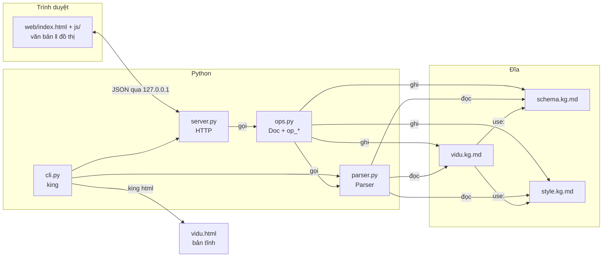

# Kiến trúc KING Markdown

Tài liệu này mô tả cách các thành phần của KING Markdown ghép với nhau. Cú pháp ngôn ngữ `.kg.md` và kế hoạch cải tiến nằm trong [documentation.kg.md](documentation.kg.md). Mã nguồn nằm trong `src/king_markdown/`.

> **KING 0.3 (nhánh `v0.3`).**
> - **Parser** chia hai bước: `parser.py` cắt block (`cut_blocks`), rồi `Parser.build` xử lý ngữ nghĩa và xuất JSON. Giá trị được đọc trong `values.py`.
> - **Code cũ** cho cú pháp v0.2 nằm trong `legacy.py`. Nó đọc các file `kg: 0.2` (file style vẫn ở định dạng này) và phục vụ `ops.py`.
> - **Đóng băng:** `ops.py` và Inspector. Mọi chỉnh sửa đi qua khung văn bản.
>
> Xem [dev/plan-v3/](../dev/plan-v3/plan-v3.md).

## 1. Nguyên tắc

1. **Văn bản là nguồn duy nhất.** Mọi trạng thái nằm trong các file `.kg.md`. Editor không giữ dữ liệu riêng; thao tác trên đồ thị được đổi thành phép sửa văn bản. Ngoại lệ duy nhất là vị trí node trên màn hình, lưu trong trình duyệt.
2. **Một cú pháp cho ba lớp.** Dữ liệu (`vidu.kg.md`), từ vựng (`schema.kg.md`) và hình thức (`style.kg.md`) đều viết bằng `.kg.md`, nên cùng một parser đọc được cả ba.
3. **Một parser.** Chỉ có `parser.py`. Server và editor không phân tích cú pháp lại; trình duyệt nhận JSON đã parse sẵn.
4. **Không phụ thuộc ngoài.** Python chỉ dùng thư viện chuẩn. Trình duyệt chỉ tải `vis-network` từ CDN.

## 2. Thành phần



| File | Dòng | Vai trò |
|---|---|---|
| `src/king_markdown/parser.py` | ~560 | Parser, kiểm lỗi theo schema, tính style |
| `src/king_markdown/ops.py` | ~370 | Lớp `Doc` và các phép sửa văn bản (`op_*`, `OPS`) |
| `src/king_markdown/server.py` | ~170 | Server HTTP cục bộ, phục vụ `web/` và API |
| `src/king_markdown/cli.py` | ~100 | Lệnh `king serve \| parse \| html`; dựng HTML tĩnh |
| `src/king_markdown/web/` | ~550 | `index.html`, `app.css`, `js/editor.js`, `js/graph.js`, `js/explorer.js`, `js/app.js` |
| `templates/schema.kg.md` | | Kiểu node, khóa meta, loại link mẫu |
| `templates/style.kg.md` | | Luật định dạng mẫu (`html.*`, `typst.*`) |
| `examples/python-course/vidu.kg.md` | | Dữ liệu ví dụ (kèm bản sao schema/style) |
| `examples/python-course/vidu.html` | | Sinh ra bằng `king html`, không sửa tay |
| `tests/` | | `test_parser.py`, `test_ops.py`, `fixtures/` |

## 3. Parser (`parser.py`)

### 3.1 Luồng xử lý

```
Parser(text, path).build()
  parse_frontmatter()      kg, use, import, from
    └ _load_uses()         load_uses(): đọc schema/style bằng Parser(bare=True)
  parse_body()             heading → section, @id → node, "- trường:" → field
                           trả danh sách link thô (node, loại, đảo?, đối số, dòng)
  resolve link             đối số → id trong file hoặc node import (kind=external)
    └ check_link_ends()    from= / to= theo schema
  check_meta()             mỗi node: khóa, allow, values, value, required
  mention                  @id trong content/ask → cạnh "mention"
  contain                  meta contain=a, b → cạnh "contain" (cha → con, cấm vòng lặp)
  contains                 parent → con, "tree": true
  check_cycles()           DFS trên các loại link dag
  to_json()
    └ apply_style()        gắn "style": {html, typst} cho từng node, link
```

### 3.2 Chế độ `bare`

`Parser(..., bare=True)` bỏ qua `use:`. Chế độ này dùng khi đọc chính `schema.kg.md` và `style.kg.md`, để tránh nạp đệ quy, và khi server cần cấu trúc của hai file đó để sửa.

### 3.3 Schema và style trong cùng một vòng đọc

`load_uses()` duyệt node của từng file trong `use:` và phân loại theo meta:

| Meta của node | Thành | Lưu ở |
|---|---|---|
| `kind=type` | kiểu node | `schema["types"][id]` |
| `kind=key` | khóa meta | `schema["keys"][id]` |
| `kind=link` | loại link | `schema["links"][id]` |
| `select=...` | luật style | `rules[]` |

Vì phân loại theo nội dung chứ không theo tên file, một file có thể chứa cả schema lẫn style.

### 3.4 Style

- `parse_select()` đổi chuỗi bộ chọn thành `{target, conds | id | type, rank}`.
- `apply_style()` sắp luật theo `(rank, order)`, rồi gộp lần lượt `html.*` và `typst.*` vào từng node/link khớp. Luật sau đè luật trước, nên độ ưu tiên cao thắng, cùng mức thì luật viết sau thắng.
- Parser tính sẵn style cuối cùng, nên mọi đầu ra (HTML, Typst) chỉ đọc trường `style`, không tự so bộ chọn.

### 3.5 Đầu ra

JSON node-link của networkx (`directed`, `multigraph`, `graph`, `nodes`, `links`). Mỗi node và link mang `line`, là số dòng trong file gốc; server dùng nó để sửa đúng chỗ. Lỗi và cảnh báo có `line`, thêm `file` nếu nằm trong schema/style.

## 4. Server (`server.py`) và phép sửa (`ops.py`)

### 4.1 API

Chỉ nghe `127.0.0.1`. Request phải có `Host` là localhost; POST phải có `Content-Type: application/json`, nên trang web khác không gửi request giả được (chống CSRF và DNS rebinding). Tên file phải là `*.kg.md` nằm ngay trong thư mục đang mở.

| Phương thức | Đường dẫn | Vào | Ra |
|---|---|---|---|
| GET | `/` | | `web/index.html` |
| GET | `/app.css`, `/js/*.js` | | file tĩnh của `web/` (chỉ các tên đã khai báo trong `ASSETS`) |
| GET | `/api/state` | | `root`, `files` |
| GET | `/api/dirs?path=` | | thư mục con, file `.kg.md` |
| GET | `/api/file?name=` | | `text`, `mtime`, `side` |
| GET | `/api/mtime?name=` | | `mtime`, `side` (mtime lớn nhất của các `.kg.md` khác) |
| POST | `/api/ping` | `id` | trang editor còn mở (gửi mỗi 10 s) |
| POST | `/api/bye` | `id` | trang đóng (`pagehide`); không còn trang nào sau 3 s thì `watch()` gọi `shutdown()`. Trang im quá 90 s coi như đã đóng. `--keep` tắt cơ chế này |
| POST | `/api/open-folder` | `path` | `root`, `files` |
| POST | `/api/new` | `name` | `name`; chép schema/style mẫu nếu thư mục chưa có |
| POST | `/api/save` | `name`, `text` | `mtime` |
| POST | `/api/parse` | `name`, `text` | JSON của parser (văn bản chưa lưu vẫn parse được) |
| POST | `/api/op` | `name`, `text`, `op`, `args` | `text` mới, kèm `id` / `msg` |

### 4.2 Lớp `Doc`

`Doc` bọc một văn bản: danh sách dòng, kết quả parse, và vị trí các heading/node nằm ngoài frontmatter và khối code (`_outline`). Mọi phép sửa đều dựa trên các thao tác của `Doc`:

| Phương thức | Việc |
|---|---|
| `node_range(id)` | dòng đầu và cuối khối của node (bỏ dòng trống cuối) |
| `insert_pos(section)` | chỗ chèn node con trực tiếp: trước heading kế tiếp, hoặc cuối file |
| `insert(pos, block)` | chèn khối, tự thêm dòng trống hai đầu |
| `cut(id)` | cắt khối node, gộp dòng trống thừa |
| `field_lines(id, key)` | các dòng `- key:` của node |
| `ensure_section(title)` | tìm heading theo tiêu đề, chưa có thì thêm cuối file |
| `ref(id)` | tên viết trong link (node import lẻ viết ngắn) |
| `again()` | parse lại sau khi sửa, để số dòng đúng cho bước sau |

### 4.3 Phép sửa (`OPS`)

| `op` | File bị sửa | Cách sửa |
|---|---|---|
| `add_node` | `.kg.md` | chèn `@id: Tiêu đề` vào section hoặc cuối file; ID sinh từ tiêu đề |
| `move_node` | `.kg.md` | `cut` rồi `insert` vào section đích |
| `delete_node` | `.kg.md` | `cut` |
| `rename` | `.kg.md` | viết lại dòng `@id:` hoặc heading, giữ comment cuối dòng |
| `add_link` | `.kg.md` | thêm `loại(B)` vào dòng `- link:` của nguồn; nguồn là section thì ghi `loại!(A)` ở đích |
| `delete_link` | `.kg.md` | bỏ một đối số hoặc cả token; dòng rỗng thì xóa dòng |
| `set_meta` | `.kg.md` | thay mọi dòng `- meta:` của node bằng một dòng; giá trị chuỗi được hiểu như khi viết tay |
| `set_field` | `.kg.md` | thay khối `- content:` / `- ask:` / `- show:` (cả dòng nối tiếp); rỗng thì xóa |
| `paste_nodes` | `.kg.md` | dán khối `@id` (Ctrl+V trên đồ thị); ID trùng đổi thành `id-2`, tham chiếu trong khối dán đổi theo |
| `comment_nodes` | `.kg.md` | thêm `// ` trước các dòng của node (Ctrl+/ trên đồ thị) |
| `set_style` | `style.kg.md` | sửa hoặc thêm node luật `select="#id"` / `select="link=loại"` |
| `schema_add` | `schema.kg.md` | thêm node `kind=type/key/link` dưới heading tương ứng |

`set_style` và `schema_add` tìm file theo vai trò qua `use_file()`: lấy file trong `use:` có nội dung đúng vai trò; nếu không có thì tạo file mẫu và thêm tên vào `use:` của `.kg.md`. Đang mở chính file schema/style thì hai phép này sửa thẳng văn bản đang mở; còn lại chúng ghi file phụ ngay trên đĩa, còn văn bản `.kg.md` trả về cho trình duyệt để trình duyệt tự lưu.

## 5. Editor (`web/`)

Các file JS là script thường (không phải module), nạp theo thứ tự và dùng chung biến toàn cục:

| File | Phần |
|---|---|
| `js/editor.js` | `ST`, `S`, tiện ích, `api()`, màu khóa meta / loại link (`keyColor()`, `linkColor()`), tô màu văn bản (`highlight()` vẽ vào `<pre id=hl>` nằm dưới textarea trong suốt), mở/lưu file, `op()` |
| `js/graph.js` | `net` (vis-network), thu gọn/bung (`buildFold()`, `toggleFold()`), `render()`, chế độ, sự kiện đồ thị, Format, Schema, `exportSVG()` |
| `js/explorer.js` | hộp chọn thư mục, File mới; Explorer (`renderExplorer()`: file + Outline); View Tree (`renderTree()`); `focusNode()` chọn node ở mọi nơi |
| `js/book.js` | View Book (`renderBook()`, Markdown tối giản `mdBlock()` / `mdInline()`) |
| `js/module.js` | View Module: `modChildren()` (quan hệ chứa), `modBox()` hộp lồng nhau, trạng thái thu gọn / loại link lồng thêm lưu trong trình duyệt |
| `js/inspect.js` | Inspector: `renderInspector()`, `nodePanel()` / `linkPanel()`, `wireInspector()` gọi `set_meta`, `set_field`, `rename`, `add_link`, `delete_link`, `set_style` |
| `js/app.js` | menu File / View / Format, `setView()`, ping/bye với server, vòng kiểm tra file trên đĩa mỗi 2 s, khởi động |

### 5.1 Trạng thái

Toàn bộ nằm trong object `S`:

| Trường | Ý nghĩa |
|---|---|
| `name`, `root` | file và thư mục đang mở |
| `text`, `dirty`, `mtime` | văn bản trong khung trái, đã lưu chưa, mtime lúc lưu/đọc gần nhất |
| `side` | mtime của các file `.kg.md` khác, để biết schema/style vừa đổi |
| `graph`, `byId`, `edgeMap` | JSON parse gần nhất; tra node theo id; tra link theo id cạnh vis |
| `mode` | `select`, `add`, `link`, `move` |
| `pending` | vị trí cho node vừa tạo, đặt trước khi vẽ lại |
| `undo` | ngăn xếp văn bản trước mỗi phép sửa (tối đa 50) |

### 5.2 Ba vòng đồng bộ

```
Gõ ở khung trái ──(0,6 s)──> /api/parse ─> render() ─> /api/save
Thao tác đồ thị ──> /api/op ─> setText() ─> /api/parse ─> render() ─> /api/save
Mỗi 2 s ──> /api/mtime ─┬─ file đang mở đổi ở nơi khác ─> tải lại (hỏi nếu đang có sửa chưa lưu)
                        └─ file khác đổi (schema/style)  ─> parse lại
```

`render()` cập nhật `DataSet` của vis-network theo id, nên node cũ giữ nguyên vị trí. Lần mở đầu tiên mà chưa có vị trí đã lưu thì bật physics để tự xếp, xếp xong thì tắt.

### 5.3 Chế độ

| Chế độ | Sự kiện vis | Gọi |
|---|---|---|
| Chọn | `click` → nhảy dòng; `doubleClick` → đổi tên; phím Delete | `rename`, `delete_node`, `delete_link` |
| + Node | `click` trên nền hoặc section | `add_node` |
| Nối | `addEdgeMode()` → `manipulation.addEdge` | `add_link` |
| Chuyển nhóm | `dragEnd`, so điểm thả với khung của các section | `move_node` |

Thanh Format gọi `set_style` cho node đang chọn (`#id`) hoặc loại link đang chọn (`link=loại`). Khi chọn link, màu nền và màu viền đều thành màu đường, độ dày viền thành độ dày đường.

### 5.4 Xuất SVG

`exportSVG()` không chụp canvas mà dựng lại SVG từ vị trí node (`getPositions`), khung bao (`getBoundingBox`) và thuộc tính đã vẽ. Cạnh được cắt tại biên hình (ellipse, hình chữ nhật, hình tròn), mũi tên dùng `<marker>`. Kết quả là ảnh vector, chữ vẫn chọn được.

### 5.5 Bản tĩnh

`king html` (`cli.static_html()`) đọc `web/index.html`, nhúng `app.css` và các file `js/` vào ngay trong trang, rồi thay `/*KG_STATIC*/null` bằng `{name, text, graph}`. Khi `ST` khác `null`, trang ẩn mọi nút sửa, khung trái chỉ đọc, không gọi server, và hiện dòng hướng dẫn mở editor.

## 6. Mở rộng

| Muốn | Sửa ở |
|---|---|
| Thêm thuộc tính `html.*` | `HTML_NODE` / `HTML_LINK` trong `parser.py`, rồi `visNode()` / `visEdges()` và `exportSVG()` trong `js/graph.js` |
| Thêm luật kiểm lỗi của ngôn ngữ | `Parser.check_meta()` hoặc `Parser.build()` |
| Thêm luật riêng của ứng dụng | đọc JSON đầu ra, đừng đưa vào parser |
| Thêm thao tác trên đồ thị | hàm `op_*` trong `ops.py`, thêm vào `OPS`, gọi `op(...)` trong `web/js/` |
| Đầu ra Typst | đọc `nodes[].style.typst` trong JSON |

## 7. Giới hạn hiện tại

- Chỉ một người dùng một lúc; hai tab cùng sửa một file sẽ ghi đè nhau (tab sau được hỏi khi phát hiện file đổi).
- Hoàn tác chỉ áp cho văn bản `.kg.md`, không áp cho `style.kg.md` / `schema.kg.md`.
- Comment `%% ... %%` giữa dòng `- link:` có thể mất khi editor viết lại dòng đó.
- Xóa link cuối cùng trên một dòng thì xóa luôn comment cuối dòng.
- Section chưa tạo được từ đồ thị; phải gõ heading ở khung trái.
- Vị trí node lưu trong `localStorage` của trình duyệt; đổi trình duyệt hay máy thì bố cục được xếp lại.
