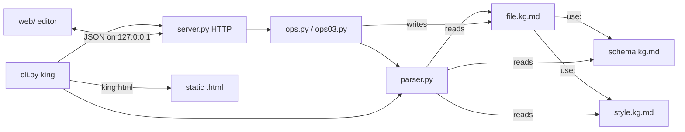

# KING Markdown architecture

How the parts of KING Markdown 0.3 fit together. The language itself is described in [documentation.kg.md](documentation.kg.md). Code lives in `src/king_markdown/` (the separate `src/kir/` package is covered in the README).

## 1. Principles

1. **Text is the single source of truth.** All state is in `.kg.md` files; graph actions become text edits. Only on-screen node positions are kept in the browser.
2. **One syntax for three layers.** Data, vocabulary (`schema.kg.md`) and presentation (`style.kg.md`) are all `.kg.md`, read by the same parser.
3. **One parser.** The server and editor never re-parse; the browser receives parsed JSON.
4. **No dependencies.** Python standard library only; the browser loads `vis-network` from a CDN.

## 2. Components



| File | Role |
|---|---|
| `parser.py` | 0.3 parser: `cut_blocks` splits blocks, `Parser.build` resolves semantics, checks the schema, computes style, emits JSON |
| `values.py` | Attribute value reader |
| `legacy.py` | 0.1/0.2 parser (style files still use this format; used by `ops.py`) |
| `ops.py` / `ops03.py` | `Doc` class and text edits `op_*` for 0.2 / 0.3 files (server picks by `kg:`) |
| `server.py` | Local HTTP server for `web/` and the API |
| `cli.py` | `king serve \| parse \| html`; builds the static page |
| `web/` | `index.html`, `app.css`, `js/*.js` |
| `templates/` | Starter `schema.kg.md` and `style.kg.md`, copied into folders that have none |

## 3. Parser

```
Parser(text, path).build()
  frontmatter        kg, use, import  → load schema/style (Parser(bare=True), no recursion)
  body               headings → sections, @node → nodes, "- key:" → attributes, raw links
  resolve links      arguments → ids in the file or imported nodes; from=/to= checked by schema
  checks             keys, allowed values, required; dag link types must be acyclic
  mentions           @id in text → "mention" edges; sections → "contains" tree edges
  to_json()          apply_style() attaches final {html, typst} style to each node and link
```

Schema and style are recognised by content, not file name (`kind=type|key|link`, `select=...`), so one file may hold both. Style rules are sorted by `(rank, order)` and merged; later rules win at equal rank. Outputs only read the precomputed `style` field.

Output is networkx node-link JSON (`directed`, `multigraph`, `graph`, `nodes`, `links`). Every node, link, error and warning carries `line` (and `file` when it comes from schema/style), which the server uses to edit the right place.

## 4. Server and edits

The server listens on `127.0.0.1` only, requires a localhost `Host` header and `Content-Type: application/json` on POST (CSRF / DNS-rebinding protection), and only serves `*.kg.md` files inside the opened folder.

| Method | Path | Purpose |
|---|---|---|
| GET | `/`, `/app.css`, `/js/*.js` | Editor assets (whitelisted) |
| GET | `/api/state`, `/api/dirs`, `/api/file`, `/api/mtime` | Folder state, file text, modification times |
| POST | `/api/ping`, `/api/bye` | Page heartbeat; the server shuts down when no page is open (unless `--keep`) |
| POST | `/api/open-folder`, `/api/new`, `/api/save` | Folder and file management |
| POST | `/api/parse` | Parse unsaved text |
| POST | `/api/op` | Apply a graph edit, return the new text |

`Doc` wraps a text (lines, parse result, outline of headings/nodes outside frontmatter and code) and offers `node_range`, `insert`, `cut`, `field_lines`, `ensure_section`, `again` (re-parse). Edits on 0.3 files: `add_node`, `rename`, `add_link`, `delete_link`, `delete_node`, `move_node`, `comment_nodes`; other ops are refused on 0.3. On 0.2 files `ops.py` also supports `set_meta`, `set_field`, `paste_nodes`, `set_style` and `schema_add`.

## 5. Editor (`web/`)

Plain scripts sharing globals, loaded in order:

| File | Part |
|---|---|
| `js/editor.js` | State `S`, `api()`, text highlighting, open/save, `op()` |
| `js/graph.js` | vis-network graph, folding, `render()`, modes, layouts, `exportSVG()` |
| `js/explorer.js` | Folder picker, Explorer and outline, Tree view, `focusNode()` |
| `js/book.js` | Book view (minimal Markdown renderer) |
| `js/module.js` | Module view (nested boxes) |
| `js/inspect.js` | Inspector (frozen in 0.3) |
| `js/app.js` | Menus, panes and tabs, `setView()`, heartbeat, file watcher, startup |

Sync loops: typing → `/api/parse` (0.6 s debounce) → `render()` → `/api/save`; graph action → `/api/op` → new text → parse → render → save; every 2 s `/api/mtime` reloads files changed elsewhere. `render()` updates vis `DataSet`s by id, so nodes keep their positions.

`exportSVG()` rebuilds a vector SVG from node positions and drawn attributes (edges clipped at shape borders, `<marker>` arrows), so text stays selectable.

**Static page.** `king html` (`cli.static_html()`) inlines `app.css` and `js/` into `index.html` and replaces `/*KG_STATIC*/null` with `{name, text, graph}`. With `ST` set, the page is read-only and never calls a server. It opens in the Book view (unless `?view=` is in the URL) and works from `file://`. The menubar (live and static) has an Explorer toggle and a Fullscreen button.

## 6. Extending

| Goal | Where |
|---|---|
| New `html.*` property | `HTML_NODE` / `HTML_LINK` in `parser.py`, then `visNode()` / `visEdges()` / `exportSVG()` in `js/graph.js` |
| New language check | `Parser.build()` and its checks |
| Application-specific rules | Read the output JSON; keep them out of the parser |
| New graph action | `op_*` in `ops03.py` (and `ops.py`), register it, call `op(...)` from `web/js/` |
| Typst output | Read `nodes[].style.typst` from the JSON |

## 7. Limitations

- Single user; two tabs editing one file overwrite each other (the later tab is asked when it notices the change).
- Undo covers the `.kg.md` text only, not `style.kg.md` / `schema.kg.md`.
- Rewriting a `- link` line may drop trailing comments on it.
- Sections cannot be created from the graph; type the heading.
- Node positions are stored in browser `localStorage`.
